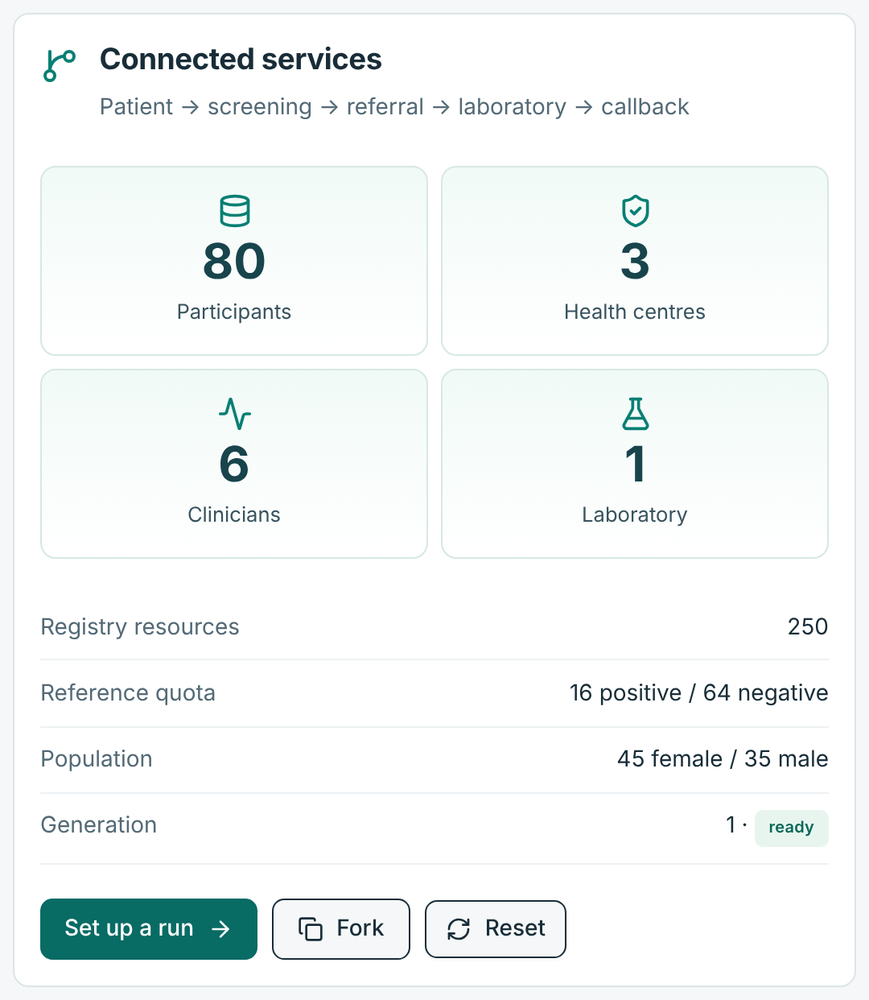
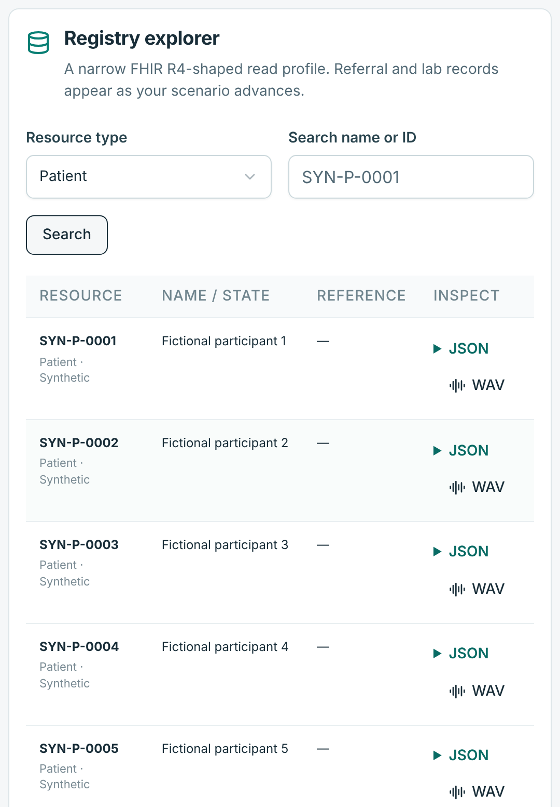
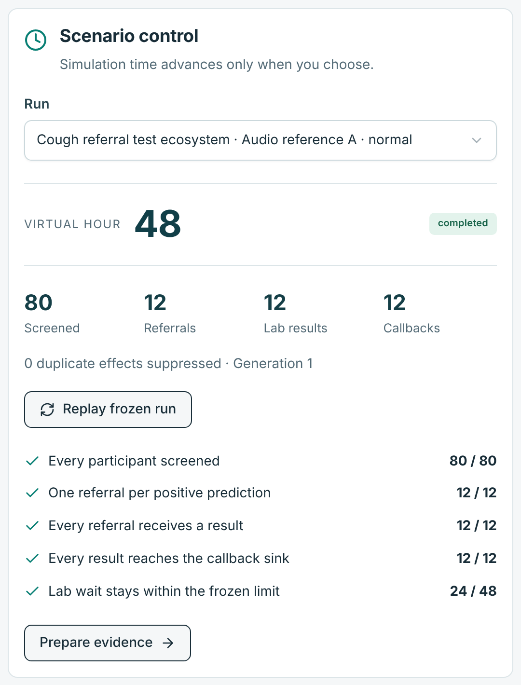
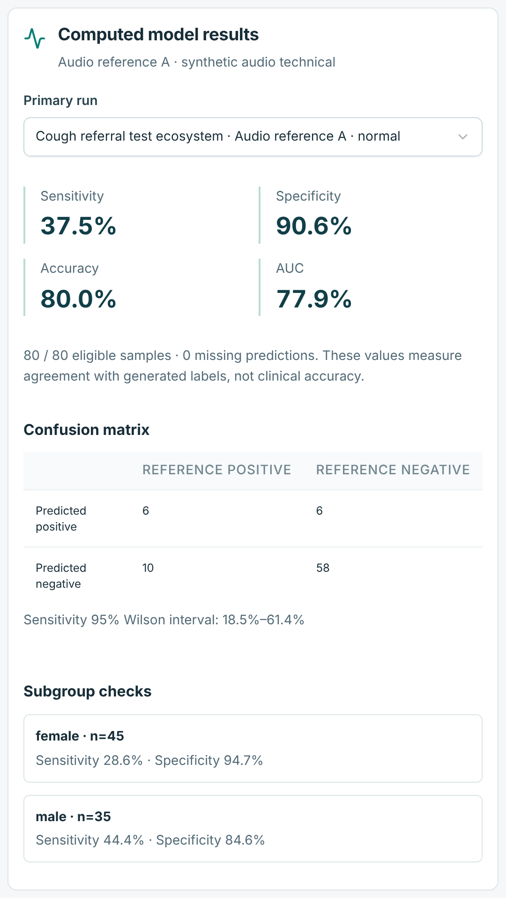
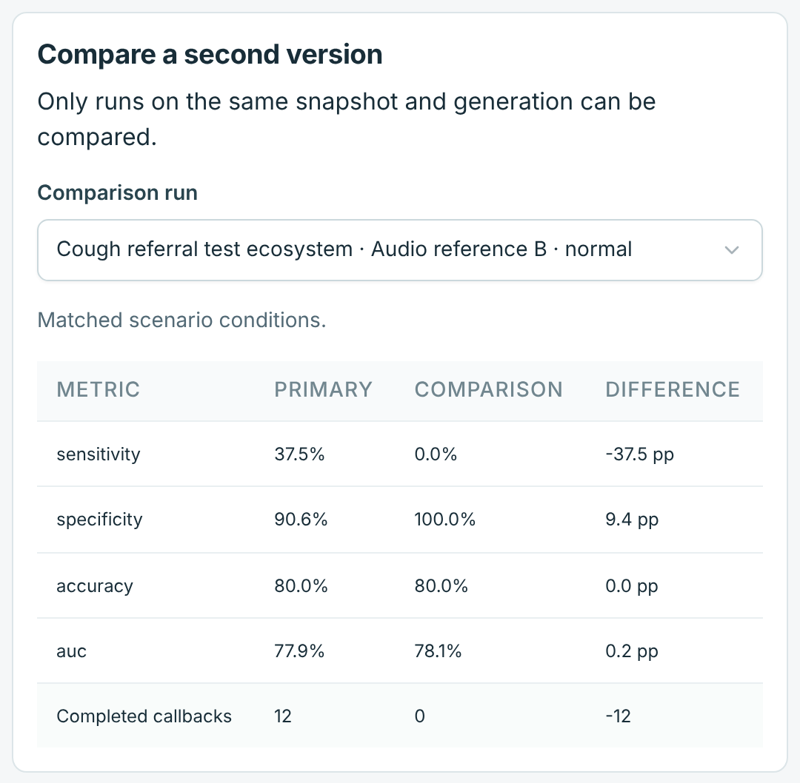
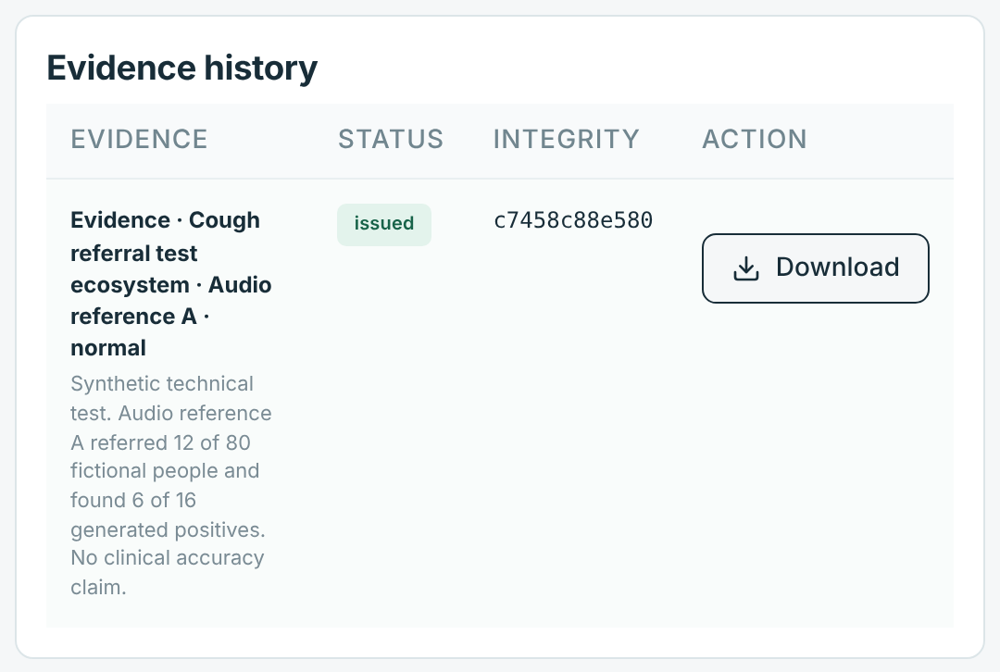

# Cough-screening demo walkthrough

Recorded 3 October 2026 on `main` at `a4b345827c95c1b0fce3ecea49926e788e8ee2b3` (v0.6.0 runtime plus PR #13 and the edition 1.1 documentation). Synthetic data only.

This is a record of what the Release 2 lab shows when the [README](../README.md) "Try it" steps are followed. It is not application acceptance, clinical evidence or a check of the deployed Site: the screens come from a disposable local copy started by [tests/demo-capture.mjs](../tests/demo-capture.mjs), not from the hosted application.

## What the application is

- It is a cough-model **testing** application. It builds a fictional health system, runs a cough model over generated audio, simulates the referral journey and scores the model against generated reference labels. It does not screen people.
- It contains no trained cough model. "Audio reference A" and "Audio reference B" are logistic functions over two features (RMS and zero-crossing rate) of generated 0.25-second PCM16 waveforms; the third choice is a deterministic workflow stub (`lib/lab.ts`). The "Example cough model API" fixture points at a `.invalid` address and sends no request (`lib/suite.ts`).
- A real model can be evaluated only through [self-service connections](SELF_SERVICE_CONNECTIONS.md), a portable model package or imported predictions. No customer model or endpoint is preconfigured.

## Walkthrough

Default settings (reproducibility seed 240925) on a fresh workspace, captured at 560 px width. Every figure measures agreement with generated labels, as the screens state; none is clinical accuracy.

**1. The fictional district.** 80 people, 3 health centres, 6 clinicians and 1 laboratory; 250 registry resources; reference quota 16 positive and 64 negative; 45 female and 35 male.



**2. The registry.** Each participant has a FHIR R4-shaped record and a generated WAV. The WAV is a test signal, not a patient cough.



**3. Audio reference A after 48 virtual hours.** 80 screened, 12 referrals, 12 laboratory results and 12 callbacks. All five journey assertions pass; the laboratory wait is 24 of the 48 permitted hours.



**4. Audio reference A results.** Sensitivity 37.5% (6 of 16 generated positives), specificity 90.6%, accuracy 80.0%, AUC 77.9%; 95% Wilson interval for sensitivity 18.5%–61.4%. Subgroups: female (n=45) sensitivity 28.6%, male (n=35) sensitivity 44.4%.



**5. A compared with B on the same snapshot.** Audio reference B: sensitivity 0.0%, specificity 100.0%, accuracy 80.0%, AUC 78.1% and no completed callbacks. Both models score 80.0% accuracy, but B refers nobody: accuracy alone would pass a model that finds no positives.



**6. Evidence.** Drafted as the programme-manager persona, then reviewed and issued as the independent-reviewer persona. The integrity code differs on every run because the harness generates new signing keys.



## Limits to state in any demonstration

- The capability register (`lib/capabilities.ts`, also downloadable from the workbench) lists 81 source requirements: 0 working, 67 working subset, 13 simulated or dummy, and 1 not connected (restricted references). The simulated items include real independent approval, application and device identity, safe external effects, FHIR profile conformance, and the availability, recovery and performance targets.
- Independent review is simulated: one signed-in owner switches between synthetic people. It tests workflow rules, not real independence.
- The hosted Site requires ChatGPT sign-in and gives each signed-in owner separate application data, so a viewer who signs in sees their own empty workspace, not the presenter's runs.
- Per the 27 September 2026 [changelog](CHANGELOG.md) entry, the hosted baseline remains v0.6.0 until it is redeployed through the hosting workflow. Whether the PR #13 fixes are deployed was not checked for this record.

## Scope checks on 3 October 2026

- No trained cough model and no oral reading fluency (ORF) model or code exists in this repository. A text search of the default branches of `saha-health` and `impact-platform` the same day found none either.

## Open cough models for tuberculosis

Status as found on 3 October 2026. Licences and access terms change; check each source before use.

| Option | What it is | Access | Published performance |
|---|---|---|---|
| CODA TB DREAM Challenge models | TB classifiers from 11 teams (cough only) and 6 teams (cough plus clinical data), submitted as ONNX models in Docker containers | Code/write-ups are listed on [Synapse](https://www.synapse.org/TBcough); controlled training data require a certified, validated account, accepted post-challenge conditions and an intended-use statement. Model artefact licences need separate review; see the permission review below. | Built from 2,143 adults with two or more weeks of cough in seven countries, including India; best AUROC 0.743 (cough only) and 0.832 (with clinical data). No model met the WHO screening target of 90% sensitivity with 70% specificity; the best combined model reached 54% specificity at 90% sensitivity ([OFID](https://academic.oup.com/ofid/article/12/10/ofaf572/8255785), [medRxiv](https://www.medrxiv.org/content/10.1101/2024.05.13.24306584v1.full)) |
| The same models, external validation | 11 cough-only models tested on 303 people in Lima, Peru | — | AUCs fell from 0.645–0.743 to 0.480–0.615; the best fell from 0.743 to 0.615, with 24.3% specificity at 90% sensitivity ([Scientific Reports, 2026](https://pmc.ncbi.nlm.nih.gov/articles/PMC13462625/)) |
| Google HeAR | Embedding model (ViT-L masked autoencoder) for two-second health sounds, trained on about 174,000 hours of audio; makes no prediction or diagnosis on its own | Gated, under the Health AI Developer Foundations terms; not open source ([Hugging Face](https://huggingface.co/google/hear)) | A TB classifier would still have to be trained and validated on labelled recordings |
| OPERA | Pretrained respiratory-audio encoders with a 19-task benchmark | MIT-licensed code and released weights ([GitHub](https://github.com/evelyn0414/OPERA)) | No tuberculosis dataset in its benchmark |

To evaluate one of these here, it would have to be hosted behind a public HTTPS JSON endpoint and connected through self-service connections. Scores on the generated test signals would mean nothing; meaningful figures need real recordings used within their data terms. HTTPS reachability does not authorise public access to protected data.

## CODA hosted-evaluation permission review — 3 October 2026

**Decision: no blanket permission to use CODA models and data in a public hosted demo.** A separately licensed model may be hosted conditionally; protected recordings and clinical rows must not be exposed to demo visitors. Private research evaluation is conditional on the accessor's approved purpose and all applicable conditions. The current demonstration remains synthetic.

Primary sources read on Synapse, including the rendered **Data Access Request** dialog for [Data folder `syn38943763`](https://www.synapse.org/Synapse:syn38943763) (open “Request to download” to read it), not just search snippets:

- [Post-Challenge Access](https://www.synapse.org/Synapse:syn31472953/wiki/622540), last modified 16 March 2024 as displayed. Access requires an active certified/validated Synapse account, acceptance of the conditions and a publicly posted English intended data use statement (IDU), at most 500 words, describing research objectives, design and analysis.
- The folder's actual access dialog additionally requires retaining control of the data and forbids redistribution, disclosure or otherwise granting access. This clause is absent from the summary wiki above. It also requires use only within the submitted IDU, safeguards against unauthorised access, no identification/contact of participants, incident/accidental-identification reporting to ACT, and the prescribed contributor/funder acknowledgement in publications and presentations. Prior challenge participants must complete the post-challenge rules for continued access.
- [Synapse governance](https://docs.synapse.org/synapse-docs/synapse-governance) and [conditions-for-use guidance](https://docs.synapse.org/synapse-docs/sharing-settings-permissions-and-conditions-for-use) distinguish publicly visible metadata from data access. Each accessor must individually satisfy controlled-data conditions; sharing an account or redistributing controlled data to collaborators is prohibited. Child files can carry additional conditions.
- [Original CODA challenge terms](https://www.synapse.org/Synapse:syn31472953/wiki/619717), last modified 27 October 2022 as displayed, restrict data to the challenge, prohibit obtaining held-out test data/sharing, and require destruction at completion. Those historical terms alone do not authorise a new demo; the current post-challenge access process is necessary.
- [DREAM Official Rules](https://www.synapse.org/Synapse:syn10144147/wiki/448310), effective 11 May 2022, section 10(a)–(c): entrants retain ownership; submitted source code uses the entrant's chosen open-source licence, with an MIT default when licensing information is absent. This is a rule about submitted **source code**, not evidence that every ONNX checkpoint, container, dependency or training dataset has an MIT licence.

| Proposed hosted use | Permission finding / project decision |
|---|---|
| Public playback/download of CODA coughs or participant rows, including via an API | Not permitted by the data-access conditions reviewed; signing in to this Site is not Synapse data authorisation. |
| Private hosted research evaluation by an approved accessor | Potentially compatible only within the accepted IDU and safeguards. Hosting/processor arrangements are not explicitly authorised by these pages; obtain documented clarification from ACT/data contributors covering the proposed cloud and external-model processing before this project imports real data. This is a project gate, not a quoted universal ban on cloud use. |
| Host a submitted cough classifier | Conditional on checking the exact code, weights, container and upstream licences and retaining required notices. No particular model artefact has been selected or cleared in this review. |
| Current local/hosted synthetic reference-model demo | Continue with repository-owned generated signals and reference models; do not describe them as CODA models or clinical validation. |

The terms review is complete; permission for a specific real-data hosted evaluation and a specific model remains conditional. No Synapse account was created, agreement accepted, access request submitted, cohort downloaded or model deployed. This documentation change does not override the repository's synthetic-only scope or change its recorded screens, performance figures or acceptance status.

## Reproduce the screens

```bash
pnpm install --frozen-lockfile
pnpm build
npm install --prefix /tmp/pw playwright-core
PLAYWRIGHT_CORE=/tmp/pw/node_modules/playwright-core CHROMIUM=/path/to/chrome \
  node tests/demo-capture.mjs --out docs/demo/cough-2026-10-03
```

The harness creates disposable local D1/R2 under `.test-state/`, starts the built Worker on 127.0.0.1:8766 with throwaway signing keys, sends synthetic identity headers only to that loopback Worker (as `tests/http.mjs` does), captures the six screens and stops the Worker. Without `--out` it writes to `.test-state/demo-screens/`. The recorded screens used Node 22.22.0, wrangler 4.92.0, playwright-core 1.56.1 and Chromium 141.0.7390.37. The harness is not part of `pnpm verify`.
