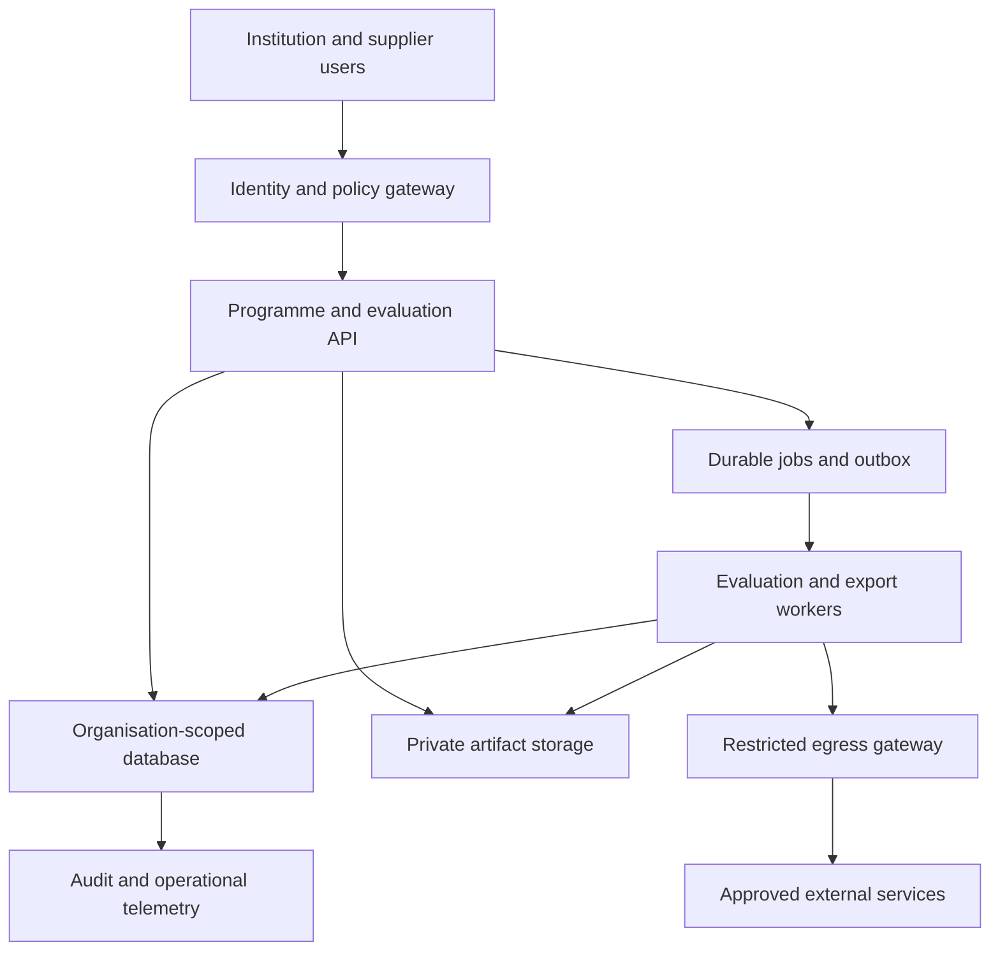

# High-level design

Status: proposed. R3A extends the existing TypeScript application with organisation-scoped modules. It does not silently convert owner-private synthetic workspaces into shared government workspaces.

## Components and trust boundaries

Identity, external egress, artifact storage, job execution and organisational boundaries require explicit controls. No credentials or hidden labels are sent to the browser or external model. Platform operators and support accounts have separate administrative authority from government evidence reviewers.

## Modules

| Module | Owns | Principal interface |
|---|---|---|
| Identity/policy | Organisations, verified principals, memberships, conflict declarations, grants | Authorise actor/action/resource/fields |
| Programme | Objectives, context profiles, source provenance | Versioned programme/context snapshot |
| Supplier | Invitations and versioned submissions | Protected supplier artifact manifest |
| Evaluation | Protocols, frozen inputs, runs and comparisons | Queue run; read findings |
| Economics | Assumptions, calculation version, costs and funding | Deterministic budget result |
| Evidence | Pack revisions, reviews, issuance and exports | Create/review/issue/download |
| Integration | Adapter configuration, credentials, test execution | Validated outbound transaction |
| Pilot | Plans, observations, windows, alerts and pauses | Ingest deduplicated observations |
| Registry/portfolio | Redacted sharing, transferability decisions, aggregate views | Authorised evidence discovery |

## Runtime choice

R3A retains the current Worker/D1/R2 deployment for development and bounded synthetic/aggregate pilots, adding typed `gov_*` tables and an organisation policy layer. D1 has no PostgreSQL row-level security or per-tenant SQL roles; application scoping and composite foreign keys are mandatory. Existing native PostgreSQL files remain a historical alternative, not a simultaneously active data tier.

Durable background execution is a new dependency: the current manual dispatcher is insufficient for R3 evaluations, export delivery and observations. Define a queue adapter with leased jobs and an outbox; bind it to provisioned infrastructure before claiming unattended execution. Untrusted uploaded binaries, arbitrary containers and GPU workloads are excluded from the R3A hosted execution boundary.

Government-selected private hosting is a separate R3C deployment profile. It must preserve contracts, org isolation, encrypted object access and job semantics and pass the same acceptance suite. It is not implemented by copying the current trusted identity-header assumptions to a general server.

## Data and evidence flow

1. A verified institution configures a programme and authorised supplier submissions.
2. The evaluator freezes a protocol and immutable input manifest.
3. Authorised start writes run, receipt, audit entry and outbox atomically.
4. A worker claims the run, rechecks authority/holds, executes bounded tasks and persists results with fencing.
5. Economics consumes versioned performance and context inputs, never a mutable dashboard value.
6. A pack snapshots results, methods, assumptions and gaps; review and issuance bind to that exact digest.
7. An authorised export service generates artifacts; access is checked when issuing download grants.

## Scale envelope and failure isolation

Initial acceptance envelope: 10 organisations, 100 programmes total, 100 simultaneous signed-in users, up to 10,000 cohort rows per approved asynchronous evaluation, 10 suppliers per comparison and a 5-year economic horizon. These are proposed validation targets, not proven capacity. The existing alpha's smaller limits continue until implementation changes and performance evidence justify raising them.

Separate interactive requests from calculation/exports. Apply per-organisation and per-connector quotas. Failure in one supplier task must not overwrite another supplier's evidence or silently shrink the denominator. Queue backpressure produces visible `queued` states. Database failure fails closed for protected writes and exports; no browser-only replacement store is permitted.

## Deployment and migration boundaries

New tables and routes are additive under `/api/v3/orgs/{orgId}`. R2 owner workspaces remain isolated. Import into R3 requires explicit owner-authorised snapshot selection, target institution permission and a recorded provenance classification. Synthetic role identities cannot be promoted to real reviewers.

Promotion is development → isolated staging → synthetic institutional pilot → jurisdiction-approved operational environment. Patient-data activation is a separate gate. Hosting region, retention, identity and support arrangements are recorded in a deployment profile before use. Backups and restore are tested against that exact profile.
