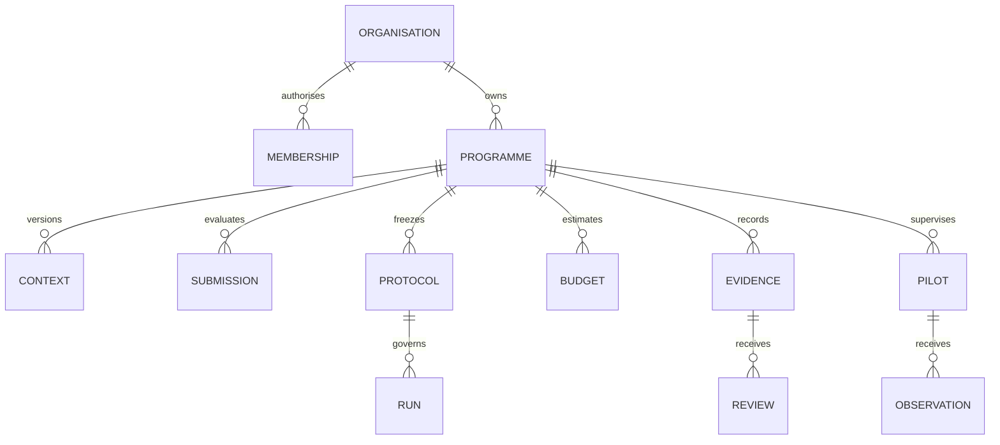

# Data model and executable candidate migrations

Status: proposed. [001-government-foundation.sql](database/001-government-foundation.sql) and [seed.sql](database/seed.sql) are executable SQLite design artefacts, deliberately outside active application migrations. The documentation check applies them to a disposable in-memory database and exercises constraints. It does not migrate any hosted database.

## Relationships

Typed resource rows use an organisation key, UUID, explicit resource kind/status, version, immutable parent references and a schema-validated JSON payload. Separate relational tables hold memberships, parent relationships, reviews, idempotency receipts, events, jobs, observations and sharing grants. JSON permits contract evolution but does not remove field validation. Composite foreign keys enforce parent organisation and expected parent type; type-specific statuses are checked by the database.

## Storage rules

| Data | Storage / access / lifecycle |
|---|---|
| Identity | Verified provider subject and stable person ID; minimum required metadata; no credentials in resource JSON |
| Organisation/programme/context | Scoped structured records with source provenance and version history |
| Supplier artifacts | Private object storage; protected metadata and immutable digest; access by assignment |
| Cohort and labels | Separate restricted artifacts; no label columns in supplier responses or public events |
| Evaluation and budget | Versioned input/result manifests; deterministic calculation version |
| Evidence | Immutable issued bytes plus revocation/supersession metadata; exact review digest |
| Secrets | Secret manager or envelope-encrypted values outside ordinary records; keys not in Git/database dumps |
| Audit/outbox | Append-only audit intent; restricted operational event contents; production durability requires external sink |
| Pilot observations | Minimum approved aggregate telemetry in R3B; event-time and source dedupe |

All IDs generated in fixtures are synthetic. Real retention periods are institution-specific decisions: configure categories, retention start, deletion eligibility and legal hold before operational use. No universal statutory duration is invented here. Delete eligibility must account for evidence dependencies; retain a minimal tombstone and audit reason where permitted. Backup expiry must follow the same policy.

## Tenant isolation and database privileges

D1/SQLite lacks PostgreSQL RLS and per-table runtime roles. The application runtime receives a dedicated database binding; migration credentials and platform administration are separate from web-user authority. Every query includes org scope; all foreign keys across org-owned records include org ID. CI tests cross-org direct inserts as well as API reads/writes/exports. Database constraints supplement, and cannot replace, authorisation.

For a future PostgreSQL deployment, runtime role must be non-owner/non-superuser without BYPASSRLS or DDL; use transaction-scoped organisation context, FORCE RLS on tenant tables, a separate migration owner and tested connection-pool reset. This is a deployment requirement, not executable PostgreSQL policy for the current D1 runtime.

## Migration promotion procedure

1. Freeze the implementing slice's contracts and candidate schema; review all cross-org relationships and state transitions.
2. Produce a new additive migration in active `drizzle/` from the schema change. Do not edit migrations already deployed or copy the candidate file into a live database manually.
3. On an isolated clone, record starting schema/version, apply in order, run foreign-key checks, count records and verify snapshots, grants and evidence hashes.
4. Run old/new application compatibility checks, then exercise the new APIs against provisioned synthetic fixtures.
5. Take a verified encrypted checkpoint, deploy schema expansion, deploy readers/writers behind feature flags and enable one synthetic organisation.
6. Compare telemetry and invariants; expand only when gate evidence passes. Record migration checksums and runtime commit.

## Rollback

Disable the feature flag, stop new jobs, reconcile leased/external operations, deploy the previous compatible application and keep additive tables. Do not drop data as a rollback. Any later contraction/backfill requires its own migration plan and rehearsed restore. A whole-database restore can lose subsequent legitimate writes and therefore requires incident-authorised recovery with an explicit recovery point.

## Open infrastructure dependencies

Government region, external audit sink, encryption key custody, backup schedule and private-cloud engine are not yet selected. They block claims for that deployment profile. Candidate SQL validation establishes syntax and selected invariants only; throughput, full authorisation and application correctness require implementation tests.
